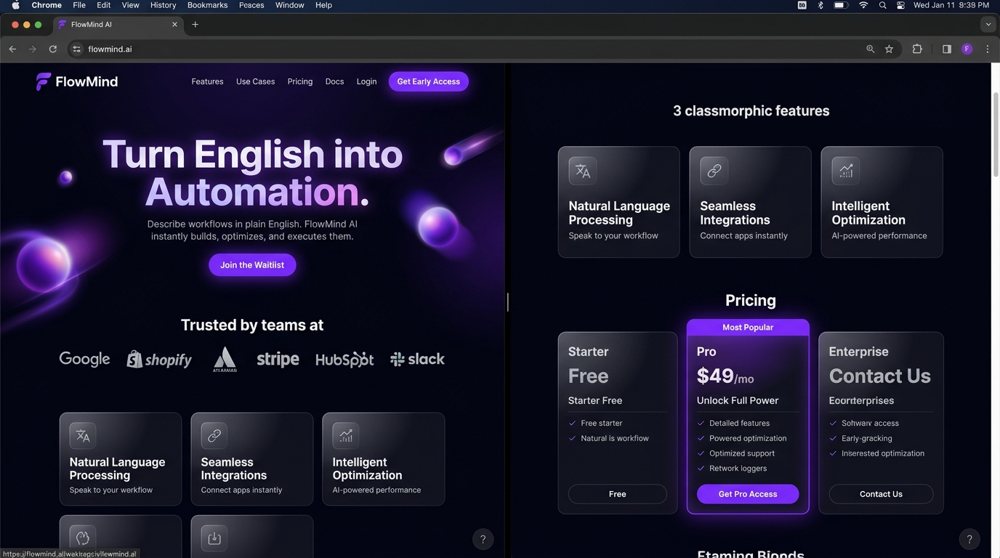

# FlowMind AI — Autonomous Workflow Automation SaaS




> **Turn English into Automated Workflows.**  
> Describe your logic in natural language. FlowMind automatically synthesizes, validates, and deploys high-throughput API integrations, webhooks, and AI agents with zero glue code.


---

## ✨ Features & Highlights

- 🧠 **Natural Language Architecture**: Convert multi-step English instructions directly into verified directed acyclic graph (DAG) execution pipelines.
- ⚡ **300+ Pre-built Integrations**: Native connectors for Stripe, HubSpot, Salesforce, Postgres, Slack, GitHub, Linear, OpenAI, Anthropic, and custom OpenAPI endpoints.
- 🛡️ **Autonomous Self-Healing**: Automated payload shape recovery and exponential backoff retry algorithms prevent midnight alert fatigue.
- 🔒 **Zero-Trust Enterprise Security**: Field-level payload encryption, CMEK, SOC2 Type II, and HIPAA compliance ready.
- 📊 **Sub-millisecond Observability**: Real-time distributed trace telemetry with OpenTelemetry native metrics.
- 🤝 **Human-in-the-Loop Safeguards**: Request instant Slack / email sign-offs before executing high-value or irreversible operations.

---

## 🎨 Design System

- **Color Palette**:
  - Deep Dark Canvas: `#050510`
  - Electric Primary Violet: `#7c3aed` / `#a855f7`
  - Accent Cyan & Blue: `#38bdf8` / `#3b82f6`
  - Status Indicators: `#22c55e` (Emerald) / `#ec4899` (Magenta)
- **Typography**:
  - Headings: `Outfit` (Google Fonts)
  - Body & UI: `Inter` (Google Fonts)
- **Glassmorphism**: Translucent multi-layered frosted cards (`backdrop-filter: blur(20px)`), subtle neon borders, and floating ambient background orbs.
- **Pure CSS UI Dashboard**: Interactive mock browser window displaying live visual DAG nodes, glowing animated signal particles, and real-time execution telemetry.

---

## 🚀 Quick Start

Open `index.html` directly in any modern browser:

```bash
# Clone the repository
git clone https://github.com/abhighna99/saas-marketing-site.git

# Navigate to project directory
cd saas-marketing-site

# Open with default browser (Windows)
start index.html

# Or serve locally using any static HTTP server:
npx serve .
# or
python -m http.server 3000
```

---

## 📁 Project Structure

```
saas-marketing-site/
├── index.html       # Semantic HTML5 layout with all specified sections
├── style.css        # Responsive dark glassmorphism styling & animations
├── script.js       # Interactive prompt switcher, billing toggle & observer
└── README.md        # Documentation and overview
```

---

## 📜 License

Distributed under the MIT License. Built with Google Antigravity.
